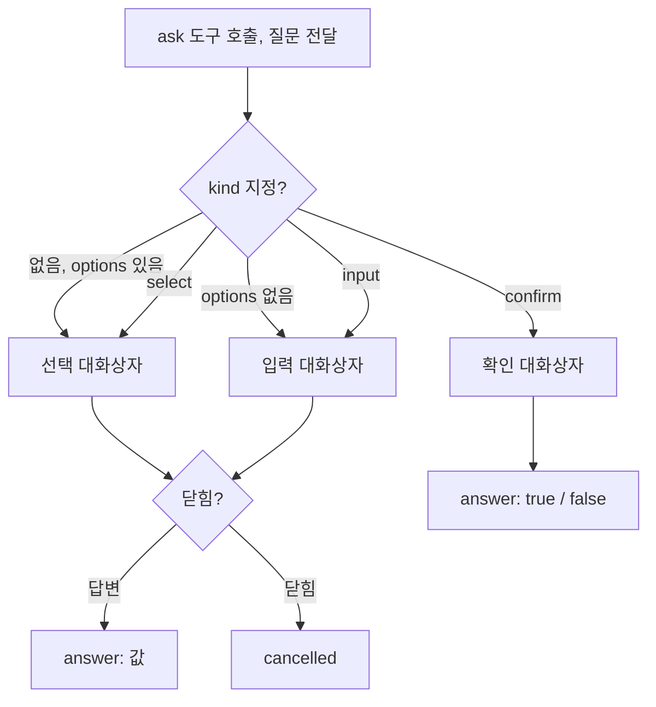

<div align="center">


# pi-ask-tool

[English](README.md) · TypeScript · Pi 확장

[](https://github.com/elfenomenokim/pi-ask-tool/blob/main/LICENSE)

[설치](#설치) · [빠르게 써 보기](#빠르게-써-보기) · [필요한 이유](#필요한-이유)

</div>

<p align="center">
  <picture>
    <source media="(prefers-color-scheme: dark)" srcset="https://raw.githubusercontent.com/elfenomenokim/pi-ask-tool/main/docs/diagrams/flow.ko.dark.svg">
    
  </picture>
</p>

**Pi 에이전트가 일하다가 사용자에게 질문 하나를 물을 수 있게 해 주는 확장입니다.** Pi에는 질문 창을 띄우는 부품(선택·확인·입력)은 있지만, 에이전트가 직접 부를 수 있는 "질문 도구"는 없습니다. 이 확장이 그 빈 곳을 채웁니다.

- **세 가지 방식:** 선택지 중 하나 고르기, 예/아니오, 직접 입력.
- **답은 글로 돌아갑니다:** 에이전트가 받은 답을 그대로 이어서 씁니다.
- **화면이 없을 때도 안전:** 헤드리스로 돌 때는 멈춰서 기다리지 않고 "화면 없음"을 돌려줍니다.

## 설치

```sh
git clone https://github.com/elfenomenokim/pi-ask-tool
cp pi-ask-tool/index.ts ~/.pi/agent/extensions/ask-tool/index.ts
```

Node 22.18 이상과 `typebox` 패키지가 필요합니다. 둘 다 Pi 실행 환경에 들어
있습니다. macOS(Apple Silicon), Node 22.23.5에서 확인했습니다.

## 빠르게 써 보기

```console
$ node docs/demo/ask.mjs
answer: codex
answer: false
answer: pi-ask-tool 0.1.0
no one to ask; proceed with your best judgment and say which assumption you made
cancelled
```

한 줄이 한 번의 호출입니다. `['cc', 'codex']` 중 `codex` 선택, 확인 거절
(`answer: false`), 자유 입력 답변, 대화상자 없는 환경에서의 대체 문구, 닫힌
대화상자의 `cancelled` 순서입니다.

## 필요한 이유

터미널 질문 도구는 이미 있습니다. [gum](https://github.com/charmbracelet/gum),
`dialog`, `whiptail`은 stdin/stdout으로 묻습니다. 하지만 Pi 안에서 에이전트는
자기 터미널이 없어 쓸 수 없습니다. `ask`는 서브프로세스 대신 Pi 내장
`ctx.ui.select` / `confirm` / `input` 대화상자를 쓰고, 소유자의 답변을 그대로
텍스트로 돌려줍니다. 대화상자를 띄울 UI가 없으면 정해진 대체 문구를 돌려줍니다.



그림 원본은 `docs/diagrams/ask.ko.mmd`입니다.

## 참고

| 매개변수 | 종류 | 용도 |
|---|---|---|
| `question` | 문자열, 필수 | 소유자에게 보여 줄 질문 |
| `options` | 문자열 2–6개, 선택 | 선택 대화상자의 보기 |
| `kind` | `select`, `confirm`, `input` 중 하나, 선택 | 쓸 대화상자. 생략하면 `options`가 있을 때 `select`, 없으면 `input` |

반환값(`content[0].text`):

| 호출 | 반환 |
|---|---|
| 답한 선택·입력 | `answer: <값>` |
| 답한 확인 | `answer: true` 또는 `answer: false` |
| 닫은 선택·입력 | `cancelled` |
| 대화상자 없는 환경(`hasUI` 거짓) | `no one to ask; proceed with your best judgment and say which assumption you made` |

맡은 일의 맥락으로 답이 안 나오는 진짜 선택에만 씁니다. 이미 맡은 일을 해도
되는지 묻는 용도가 아닙니다.

## 한계

- Pi 확장으로만 돕니다. Pi 런타임이 주는 `ctx.ui`를 호출합니다.
- 선택지는 2–6개입니다. Pi UI의 상한입니다.
- 대화상자에 도구 차원의 시간 제한은 없습니다. 닫으면 `cancelled`을 돌려줍니다.
- `confirm` 호출은 `ctx.ui.confirm`에 빈 상세 문자열을 넘깁니다.

## 기여

이슈와 풀 리퀘스트를 환영합니다. 확인할 점은
[CONTRIBUTING.md](CONTRIBUTING.md)에 있습니다. 테스트를 돌리고 결과를 보여
주세요.

## 라이선스

MIT. [LICENSE](LICENSE)를 보세요.
