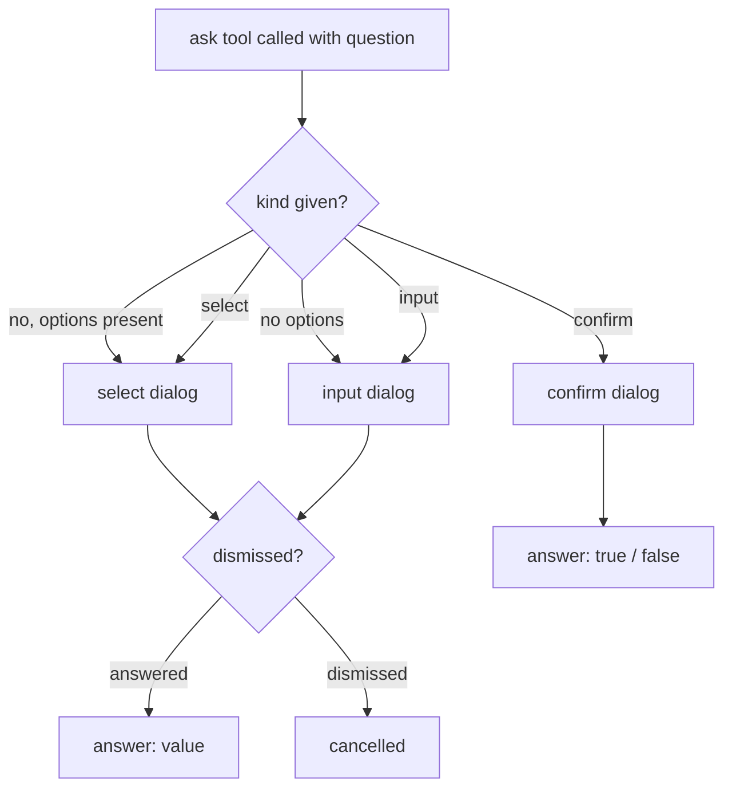

<div align="center">


# pi-ask-tool

[한국어](README.ko.md) · TypeScript · Pi extension

[](https://github.com/elfenomenokim/pi-ask-tool/blob/main/LICENSE)

[Install](#install) · [Quick start](#quick-start) · [Why](#why)

</div>

<p align="center">
  <picture>
    <source media="(prefers-color-scheme: dark)" srcset="https://raw.githubusercontent.com/elfenomenokim/pi-ask-tool/main/docs/diagrams/flow.dark.svg">
    
  </picture>
</p>

**A Pi extension that lets an agent ask the user one question mid-task.** Pi ships the dialog primitives (select, confirm, input) but no tool an agent can call to ask; this extension is that tool.

- **Three kinds:** pick one option, yes or no, or type an answer.
- **The answer comes back as text** the agent can act on.
- **Safe without a screen:** in a headless run it returns a no-UI result instead of hanging.

## Install

```sh
pi install npm:pi-ask-tool
```

Or copy the single file:

```sh
git clone https://github.com/elfenomenokim/pi-ask-tool
mkdir -p ~/.pi/agent/extensions/ask-tool
cp pi-ask-tool/index.ts ~/.pi/agent/extensions/ask-tool/index.ts
```

Node 22.18 or newer and the `typebox` package are required; `pi install` fetches
`typebox`, and Pi provides it at runtime for the copied file. Tested on macOS (Apple Silicon) with Node 22.23.5.

## Quick start

```console
$ node docs/demo/ask.mjs
answer: codex
answer: false
answer: pi-ask-tool 0.1.0
no one to ask; proceed with your best judgment and say which assumption you made
cancelled
```

Each line is one call: a choice from `['cc', 'codex']` answered `codex`; a confirm
declined (`answer: false`); a free-text answer; the same choice with no
dialog-capable UI, which returns a fallback instead of asking; and a dismissed
dialog, which returns `cancelled`.

## Why

Terminal prompters already exist: [gum](https://github.com/charmbracelet/gum),
`dialog` and `whiptail` ask through stdin/stdout. They do not work inside Pi,
where the agent has no terminal of its own. `ask` uses Pi's built-in
`ctx.ui.select` / `confirm` / `input` dialogs instead of spawning a subprocess,
returns the owner's exact answer as text, and degrades to an explicit fallback
string when no dialog-capable UI is attached.



The diagram source is `docs/diagrams/ask.mmd`.

## Reference

| Parameter | Type | Purpose |
|---|---|---|
| `question` | string, required | The question shown to the owner |
| `options` | 2–6 strings, optional | Choices for a selection |
| `kind` | `select`, `confirm` or `input`, optional | Dialog to use; defaults to `select` when `options` exist, otherwise `input` |

Return values (`content[0].text`):

| Call | Returns |
|---|---|
| Answered select or input | `answer: <value>` |
| Answered confirm | `answer: true` or `answer: false` |
| Dismissed select or input | `cancelled` |
| No dialog-capable UI (`hasUI` false) | `no one to ask; proceed with your best judgment and say which assumption you made` |

Use it only for a choice the assigned task cannot settle from available context.
It never asks permission to perform work already assigned.

## Limits

- Runs only as a Pi extension: it calls `ctx.ui` provided by the Pi runtime.
- A selection holds 2–6 options; that bound comes from Pi's UI.
- Dialogs have no tool-level timeout. A dismissed dialog returns `cancelled`.
- The `confirm` call passes an empty detail string to `ctx.ui.confirm`.

## Contributing

Issues and pull requests are welcome. See [CONTRIBUTING.md](CONTRIBUTING.md) for
the check that matters: run the suite and show its result.

## License

MIT. See [LICENSE](LICENSE).
